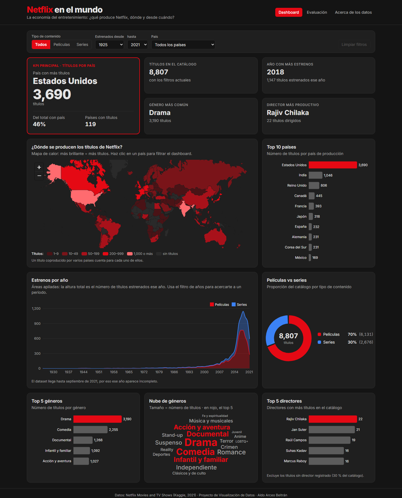

# Netflix en el mundo 🎬

**La economía del entretenimiento: Netflix y tendencias globales**
Proyecto de la materia de Visualización de Datos (Proyecto 3: Negocios y cultura digital).

**Autor:** Aldo Arceo Beltrán

🔗 **Dashboard en vivo:** _(se agrega al desplegar en Vercel)_
📊 **Dataset:** [Netflix Movies and TV Shows (Kaggle)](https://www.kaggle.com/datasets/shivamb/netflix-shows): 8 807 títulos, catálogo hasta septiembre de 2021



---

## ¿Qué es?

Es un dashboard interactivo hecho en **React** que analiza el catálogo de Netflix para responder una pregunta:

> **¿Dónde, cuándo y de qué géneros produce Netflix su catálogo, y cómo cambian los gustos por región y año?**

| KPI | Gráfico |
|---|---|
| ⭐ **KPI principal: número de títulos por país** | Mapa de calor + Top 10 países |
| Evolución de estrenos por año | Gráfico de área (películas y series) |
| Top 5 géneros | Barras + nube de palabras |
| Top 5 directores más productivos | Barras |
| Películas vs series | Gráfico de anillo (dona) |

Todo se puede filtrar por **tipo de contenido**, **rango de años** y **país**. El país también se elige haciendo clic en el mapa.

## Hallazgos principales

- **Estados Unidos** concentra el 46% de los títulos con país conocido (3 690). Le siguen **India** (1 046) y **Reino Unido** (806).
- El catálogo es muy reciente: el **71% de los títulos se estrenó de 2015 en adelante**, y el pico fue **2018** con 1 147 estrenos.
- Netflix es mayoritariamente de **películas (70%)**. Aun así, desde 2018 las películas bajan y las series suben; en 2021 ya hubo más series (315) que películas (277).
- Los gustos cambian por región: **India** tiene casi solo películas (92%) y sobre todo dramas; **Japón** es anime; **Corea del Sur** es romance.

## Documentación por fase

| Fase | Documento | PDF |
|---|---|---|
| 1. Análisis | [fase-1-analisis.md](docs/fase-1-analisis.md) | [PDF](docs/pdf/fase-1-analisis.pdf) |
| 2. Diseño (KPIs, paleta, wireframe) | [fase-2-diseno.md](docs/fase-2-diseno.md) | [PDF](docs/pdf/fase-2-diseno.pdf) |
| 3. Implementación en React | [fase-3-implementacion.md](docs/fase-3-implementacion.md) | [PDF](docs/pdf/fase-3-implementacion.pdf) |
| 4. Evaluación con usuarios | [fase-4-evaluacion.md](docs/fase-4-evaluacion.md) | [PDF](docs/pdf/fase-4-evaluacion.pdf) |

## Tecnologías

| Parte | Herramienta |
|---|---|
| Frontend | React + Vite, React Router |
| Gráficos | Recharts, d3-cloud (nube de palabras) |
| Mapa | React-Leaflet + polígonos de Natural Earth |
| Estilos | TailwindCSS (con la paleta de la Fase 2) |
| Base de datos | PostgreSQL en Supabase |
| Limpieza de datos | Python + pandas |
| Publicación | GitHub + Vercel |

## Estructura del repositorio

```
netflix-dashboard/
├── data/raw/            dataset original de Kaggle
├── data/clean/          datos limpios (salida de etl/limpieza.py)
├── etl/                 scripts de Python: limpieza, carga a la BD y análisis de la encuesta
├── database/schema.sql  tablas, vistas de KPIs y seguridad de la base de datos
├── web/                 el dashboard en React
└── docs/                documentos de cada fase, imágenes y PDFs
```

## Cómo correrlo en tu computadora

```bash
# 1) Limpieza de datos (Python 3.12 o superior)
python -m venv .venv
.venv/Scripts/pip install -r etl/requirements.txt
.venv/Scripts/python etl/limpieza.py

# 2) Dashboard
cd web
npm install
npm run dev        # abre http://localhost:5173
```

Para conectar la base de datos, revisa los pasos en [docs/fase-3-implementacion.md](docs/fase-3-implementacion.md#base-de-datos).
