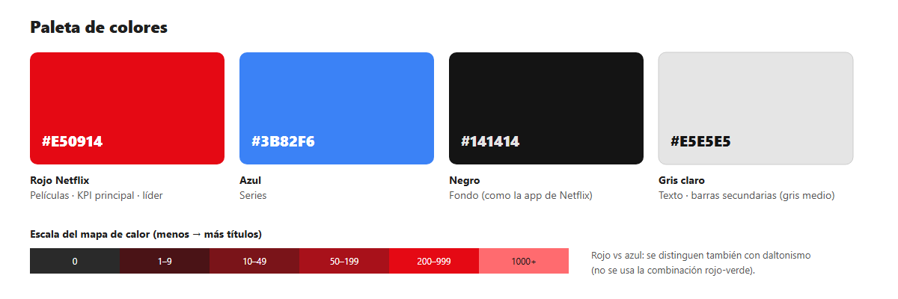
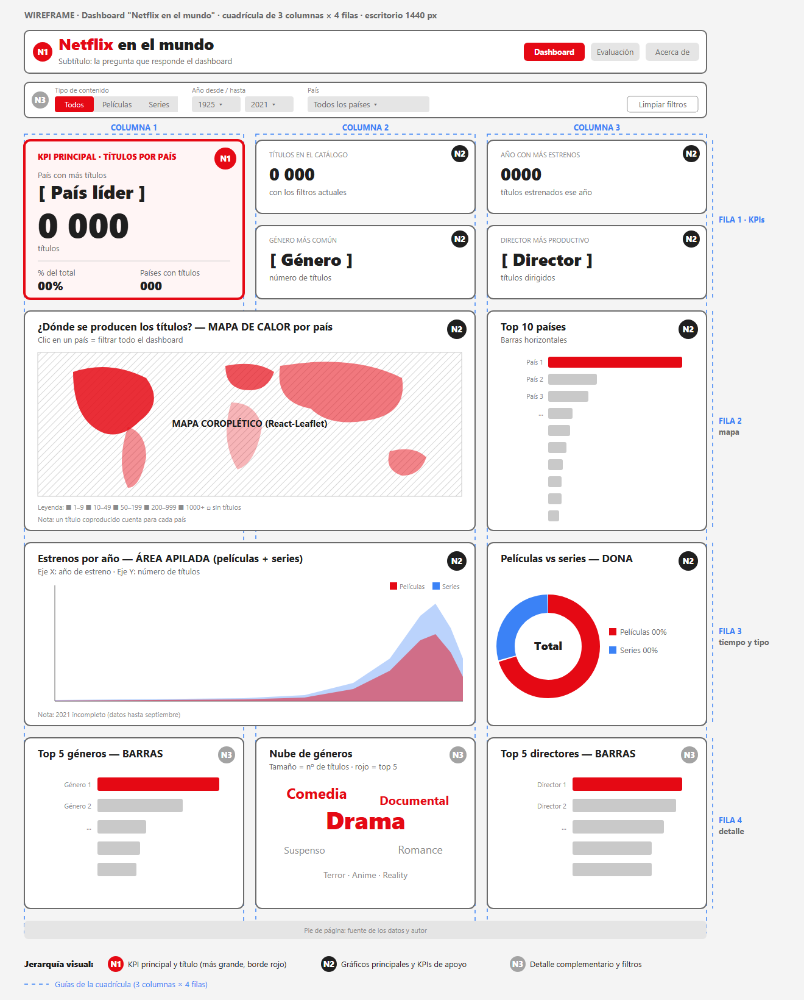

# Fase 2 · Diseño: KPIs, gráficos, paleta y wireframe

**Proyecto:** Netflix en el mundo · **Autor:** Aldo Arceo Beltrán

> Objetivo de esta fase: planear **qué** se muestra, **con qué gráfico**, **con qué colores** y **dónde va cada cosa**, antes de escribir código.

**Pregunta central del proyecto:** *¿Dónde, cuándo y de qué géneros produce Netflix su catálogo, y cómo varían los gustos por región y año?*

---

## 1. KPI principal y KPIs complementarios

### ⭐ KPI principal: número de títulos por país

**¿Por qué es el principal?**
- Responde directamente la parte central de la pregunta: *"cómo los gustos varían por región"*. Sin saber **dónde** se produce, los demás datos no tienen contexto.
- Es el primer KPI que pide el enunciado del proyecto y el único que se puede ver en un **mapa**, la visualización más llamativa e intuitiva.
- Revela el hallazgo más fuerte del dataset: **Estados Unidos concentra el 46%** de los títulos con país conocido, más del triple que India, que es el segundo lugar.

**¿Qué aporta a la comprensión del fenómeno?**
Muestra que Netflix, aunque es global, depende mucho de pocos países productores (EE. UU., India, Reino Unido). Al hacer clic en un país, todos los demás KPIs se recalculan, así que este KPI también funciona como **puerta de entrada** para comparar regiones.

**Cómo se presenta:** una tarjeta grande con el país líder, su número de títulos, su porcentaje del total y cuántos países tienen títulos. Se acompaña de un mapa de calor y un ranking de los 10 primeros países.

### KPIs complementarios (4)

| # | KPI | ¿Qué explica del KPI principal? |
|---|---|---|
| 2 | **Evolución de estrenos por año** | *Cuándo* creció el catálogo (el 71% es de 2015 en adelante) |
| 3 | **Top 5 géneros** | *Qué* se produce (Drama, Comedia, Documental…) |
| 4 | **Top 5 directores más productivos** | *Quién* produce más títulos para la plataforma |
| 5 | **Películas vs series** | *En qué formato* (70% películas / 30% series) |

---

## 2. Tipo de gráfico para cada KPI

| KPI | Gráfico | Justificación breve |
|---|---|---|
| ⭐ Títulos por país | **Mapa de calor (coroplético)** | Es distribución **geográfica**: el mapa es la forma natural de mostrar "dónde". El color más intenso indica más títulos. |
| ⭐ Títulos por país (detalle) | **Barras horizontales (Top 10)** | El mapa no deja comparar números exactos; las barras sí. Van horizontales porque los nombres de países son largos. |
| Estrenos por año | **Área apilada** (línea rellena) | Es una **tendencia en el tiempo**. Al apilar películas y series se ven el total y la mezcla a la vez. |
| Top 5 géneros | **Barras horizontales** | Es una **comparación entre categorías**; la barra permite ver fácilmente cuál es mayor. |
| Géneros (panorama) | **Nube de palabras** | La sugiere el enunciado; da una vista rápida de **todos** los géneros, donde el tamaño es la cantidad. Complementa las barras, no las reemplaza. |
| Top 5 directores | **Barras horizontales** | Igual que los géneros: es un ranking entre categorías. |
| Películas vs series | **Anillo (dona)** | Es una **proporción simple de solo 2 categorías**, dentro del límite de 5 recomendado para pastel/anillo. |

**Gráficos descartados:**
- No se usó un pastel para los géneros, porque son 20 categorías y sería ilegible.
- No se usó un gráfico de dispersión, porque no hay dos variables numéricas cuya relación sea parte de la pregunta.

---

## 3. Paleta de colores

| Color | Hex | Uso |
|---|---|---|
| Rojo Netflix | `#E50914` | Películas, KPI principal y el **primer lugar** de cada ranking |
| Azul | `#3B82F6` | Series |
| Negro | `#141414` | Fondo |
| Gris claro | `#E5E5E5` | Texto (y un gris medio para las barras que no son el primer lugar) |

**Mapa de calor:** escala **de un solo tono** (rojos), de oscuro (pocos títulos) a brillante (muchos títulos). Los países sin títulos van en gris.

**Justificación:**
- **Coherencia temática:** el rojo y el negro son la identidad visual de Netflix. El usuario relaciona el dashboard con la marca de inmediato, como se sugiere con el ejemplo "sustentabilidad → verdes".
- **Visibilidad y contraste:** el fondo oscuro hace que el rojo resalte. El texto gris claro sobre negro supera la relación de contraste mínima recomendada (WCAG AA).
- **Accesibilidad (daltonismo):** se evitó la combinación rojo-verde. Para la segunda categoría se eligió **azul**, que se distingue del rojo con cualquier tipo de daltonismo. Se verificó con un validador de paletas: diferencia ΔE = 31.8 en deuteranopía, cuando el mínimo recomendado es 8. Además, cada color siempre va acompañado de una **etiqueta con texto**, así que la información nunca depende solo del color.
- **Uso con intención:** el rojo se reserva para **lo más importante** (KPI principal, primer lugar, películas). Por eso las barras que no son el primer lugar van en gris y el líder salta a la vista.

---

## 4. Wireframe

Hecho como boceto vectorial (SVG), en escala de grises con acentos de la paleta. No usa datos reales: solo define la **estructura**.

**Qué incluye:**
- **Título general** con un subtítulo que plantea la pregunta.
- **Navegación:** Dashboard, Evaluación y Acerca de los datos.
- **Barra de filtros** en una sola fila arriba: tipo, años y país.
- **Panel superior de KPIs:** el KPI principal más grande, a la izquierda, y 4 KPIs de apoyo.
- **Gráficos principales:** mapa y Top 10 países; estrenos por año y dona.
- **Mapa** con leyenda de la escala de color.
- **Detalle:** Top 5 géneros, nube de géneros y Top 5 directores.
- **Leyendas, etiquetas y notas** en cada gráfico (por ejemplo, "2021 incompleto").

---

## 5. Cuadrícula y jerarquía visual

**Cuadrícula:** 3 columnas iguales × 4 filas (las guías azules punteadas del wireframe).

| Fila | Columna 1 | Columna 2 | Columna 3 |
|---|---|---|---|
| 1 · KPIs | **KPI principal** (2 alturas) | Títulos totales / Género #1 | Año pico / Director #1 |
| 2 · Dónde | Mapa de calor (ocupa 2 columnas) | ← | Top 10 países |
| 3 · Cuándo y cómo | Estrenos por año (ocupa 2 columnas) | ← | Películas vs series |
| 4 · Detalle | Top 5 géneros | Nube de géneros | Top 5 directores |

**Prioridad visual:**

| Nivel | Elementos | Cómo se destaca |
|---|---|---|
| **N1** | Título del dashboard y **KPI principal** | Posición arriba a la izquierda (donde empieza la lectura), tamaño más grande, **único borde rojo** y número de 48 px |
| **N2** | Gráficos principales (mapa, línea, dona, top países) y KPIs de apoyo | Filas 1–3; el mapa y la línea ocupan 2 columnas |
| **N3** | Información complementaria (géneros, nube, directores) y filtros | Fila inferior, tarjetas del mismo tamaño |

**Flujo de lectura:** de lo general a lo particular, en forma de "Z": primero el KPI principal, luego dónde (mapa), luego cuándo (año) y al final qué y quién (géneros y directores). Así se cumple la regla de ir "de KPI general a detalle".
