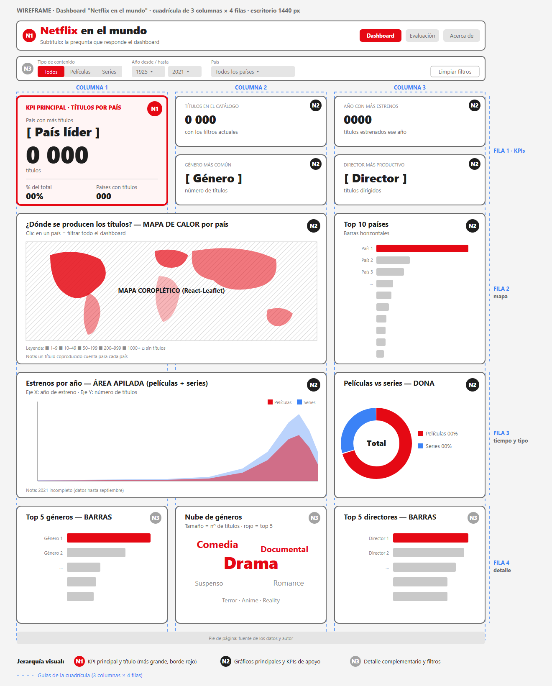
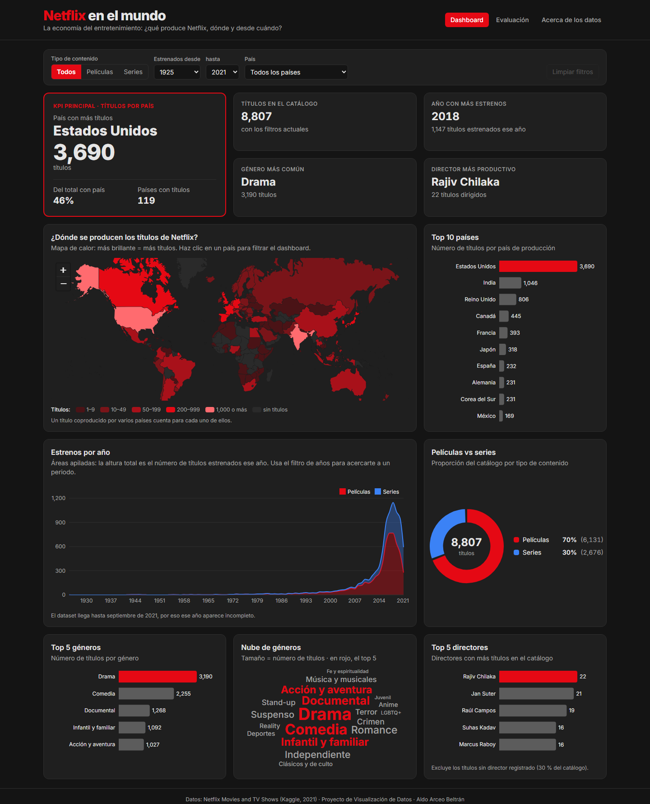
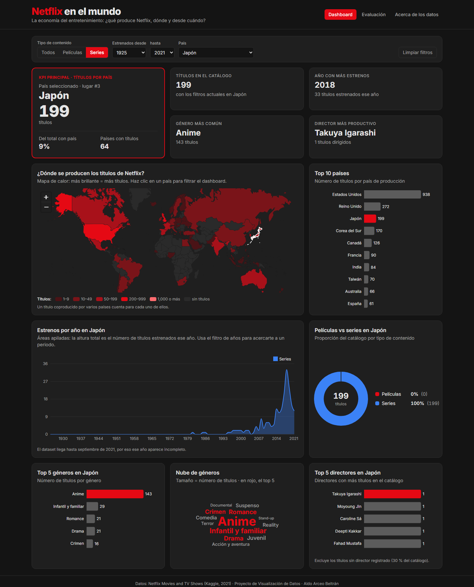

# Fase 3 · Implementación del dashboard en React

**Proyecto:** Netflix en el mundo · **Autor:** Aldo Arceo Beltrán

---

## 1. Introducción

**Objetivo del dashboard:** mostrar cómo se distribuye y cómo ha evolucionado el catálogo de Netflix por país, año y género (Fase 1).

**Propósito de esta fase:** convertir el wireframe de la Fase 2 en un dashboard funcional y respetar tres decisiones de diseño:
1. La misma **estructura**: cuadrícula de 3 columnas × 4 filas.
2. Los mismos **KPIs y gráficos**.
3. La misma **paleta y jerarquía visual**.

El resultado es una aplicación web con tres secciones:
- **Dashboard:** los KPIs y gráficos.
- **Evaluación:** la encuesta de la Fase 4.
- **Acerca de los datos:** fuente y limpieza aplicada.

---

## 2. Estructura del proyecto

La carpeta `components/` está organizada igual que el wireframe: **KPIs**, **gráficos** y **diseño general**.

```
web/
├── public/data/                 Datos que lee el dashboard
│   ├── netflix.json             8 807 títulos limpios (salida de etl/limpieza.py)
│   ├── paises_iso.json          Código de cada país (para unir datos con el mapa)
│   ├── mundo.json               Polígonos de los países (Natural Earth)
│   └── reporte_limpieza.json    Números de la limpieza (página "Acerca de")
└── src/
    ├── main.jsx                 Punto de entrada (activa React Router)
    ├── App.jsx                  Encabezado + rutas de las 3 páginas
    ├── index.css                Tailwind + variables de color de la paleta
    ├── theme/colores.js         ★ La paleta de la Fase 2 (única fuente de colores)
    ├── data/useNetflixData.js   Carga los datos con Fetch
    ├── lib/
    │   ├── kpis.js              ★ Cálculo de todos los KPIs (funciones puras)
    │   └── supabase.js          Conexión a la base de datos
    ├── components/
    │   ├── layout/              Encabezado (título + menú) y Filtros
    │   ├── kpis/                KpiPrincipal (N1) y KpiTarjeta (N2)
    │   ├── charts/              MapaPaises, LineaEstrenos, DonaTipo, BarrasTop, NubeGeneros
    │   └── ui/Tarjeta.jsx       Contenedor común: título + subtítulo + nota
    └── pages/
        ├── Dashboard.jsx        ★ Arma la cuadrícula del wireframe
        ├── Evaluacion.jsx       Encuesta (Fase 4)
        └── AcercaDe.jsx         Fuente y limpieza de datos
```

Fuera de `web/`:

| Carpeta | Contenido |
|---|---|
| `etl/` | Scripts de Python: `limpieza.py`, `cargar_supabase.py`, `analizar_encuesta.py` |
| `database/` | `schema.sql`: tablas, vistas de KPIs y reglas de seguridad |
| `data/` | CSV original y CSV limpios |
| `docs/` | Documentos de cada fase e imágenes |

---

## 3. Justificación técnica

Se usó el **stack sugerido** en las indicaciones:

| Herramienta | ¿Para qué? | ¿Por qué esta? |
|---|---|---|
| **React + Vite** | Estructura base | Vite arranca al instante y genera una versión optimizada para publicar |
| **React Router** | Navegación entre Dashboard, Evaluación y Acerca de | Cada sección tiene su propia dirección (`/evaluacion`) |
| **Fetch** | Cargar los datos JSON | Viene incluido en el navegador; no hace falta instalar Axios |
| **Recharts** | Barras, área y dona | Se escribe como componentes de React, es fácil de personalizar y trae tooltips |
| **React-Leaflet** | Mapa de calor | Es la librería de mapas sugerida; permite colorear cada país y hacer clic en él |
| **d3-cloud** | Nube de palabras | Calcula la posición de las palabras sin que se encimen (Recharts no tiene nube) |
| **TailwindCSS** | Estilos | La paleta se define una vez como variables y se usa en todo el proyecto |
| **Supabase** (PostgreSQL) | Base de datos y encuesta | Base de datos real y gratuita, con reglas de seguridad |

**Decisión importante:** todos los KPIs se calculan **en el navegador**, a partir de `netflix.json`, en el archivo `lib/kpis.js`. Así, al mover un filtro, todo se actualiza al instante sin esperar a la base de datos. Los 8 807 títulos pesan 1.2 MB, una cantidad pequeña.

---

## 4. Correspondencia diseño ↔ implementación

### Wireframe (Fase 2)


### Dashboard implementado


| Elemento del wireframe | En el dashboard | ¿Se respetó? |
|---|---|---|
| Título "Netflix en el mundo" + subtítulo + menú | `Encabezado.jsx` | ✅ Igual |
| Barra de filtros en una fila (tipo, años, país, limpiar) | `Filtros.jsx` | ✅ Igual |
| **KPI principal** arriba a la izquierda, 2 alturas, borde rojo | `KpiPrincipal.jsx` | ✅ Igual |
| 4 KPIs de apoyo en 2 × 2 | `KpiTarjeta.jsx` × 4 | ✅ Igual |
| Fila 2: mapa (2 columnas) + Top 10 países | `MapaPaises.jsx` + `BarrasTop.jsx` | ✅ Igual |
| Fila 3: estrenos por año (2 columnas) + dona | `LineaEstrenos.jsx` + `DonaTipo.jsx` | ✅ Igual |
| Fila 4: Top 5 géneros, nube, Top 5 directores | `BarrasTop.jsx` × 2 + `NubeGeneros.jsx` | ✅ Igual |
| Primer lugar en rojo, resto en gris | `BarrasTop.jsx` | ✅ Igual |

**Diferencias (mejoras pequeñas):**
- El mapa tiene botones de **+ / −** para acercarse.
- El KPI principal **cambia al país elegido** cuando se filtra; por ejemplo, muestra "Japón · lugar #3".
- En celular, las columnas se apilan una debajo de otra.

**Filtros en acción:** ejemplo con Series + Japón. Todos los KPIs se recalculan y Japón queda marcado en el mapa y en el ranking.



---

## 5. Implementación de los KPIs

Todos se calculan en [`web/src/lib/kpis.js`](../web/src/lib/kpis.js). Primero se aplican los filtros (`filtrar()`) y después cada función cuenta.

| KPI | Cómo se calcula | Función | Dónde se muestra |
|---|---|---|---|
| ⭐ **Títulos por país** | Cuenta los títulos de cada país. Un título con 2 países suma 1 a cada uno. Participación = títulos del país ÷ títulos con país conocido | `titulosPorPais()` | `KpiPrincipal`, `MapaPaises`, Top 10 |
| Estrenos por año | Para cada año del rango, cuenta películas y series por separado; el año pico es el de mayor total | `estrenosPorAnio()` | `LineaEstrenos` + tarjeta "Año con más estrenos" |
| Top 5 géneros | Cuenta los títulos de cada género, ordena y toma los 5 primeros | `topGeneros()` | `BarrasTop` + `NubeGeneros` + tarjeta "Género más común" |
| Top 5 directores | Igual que géneros, sin contar los "Desconocido" | `topDirectores()` | `BarrasTop` + tarjeta "Director más productivo" |
| Películas vs series | Cuenta cada tipo y lo divide entre el total | `peliculasVsSeries()` | `DonaTipo` |

**Valores con todos los datos (sin filtros):**

| KPI | Valor |
|---|---|
| País líder | Estados Unidos, 3 690 títulos (46%), de 119 países |
| Año con más estrenos | 2018, con 1 147 títulos |
| Top 5 géneros | Drama 3 190 · Comedia 2 255 · Documental 1 268 · Infantil y familiar 1 092 · Acción y aventura 1 027 |
| Top 5 directores | Rajiv Chilaka 22 · Jan Suter 21 · Raúl Campos 19 · Suhas Kadav 16 · Marcus Raboy 16 |
| Películas / series | 6 131 (70%) / 2 676 (30%) |

Estas mismas cifras se obtienen con las vistas SQL de `database/schema.sql`. Así se comprobó que el dashboard y la base de datos coinciden.

---

## 6. Implementación de los gráficos

| Gráfico (Fase 2) | Componente | Librería | Detalles |
|---|---|---|---|
| Mapa de calor | `MapaPaises.jsx` | React-Leaflet | Tooltip con país y número; clic = filtrar |
| Barras horizontales | `BarrasTop.jsx` | Recharts | Valor escrito al final de cada barra; el líder en rojo |
| Área apilada por año | `LineaEstrenos.jsx` | Recharts | Leyenda, tooltip con el total del año y nota "2021 incompleto" |
| Dona | `DonaTipo.jsx` | Recharts | Total al centro; leyenda con % y cantidad |
| Nube de palabras | `NubeGeneros.jsx` | d3-cloud | Tamaño = títulos; top 5 en rojo; palabras sin girar para leerlas mejor |

Todos coinciden con lo definido en la Fase 2. Todos los gráficos van dentro de `Tarjeta.jsx`, que siempre tiene:
- un **título** que dice qué muestra;
- un **subtítulo** que dice cómo leerlo;
- una **nota** cuando hace falta una aclaración.

---

## 7. Implementación del mapa

- **Datos que se pintan:** el conteo de títulos por país del KPI principal.
- **Polígonos de los países:** [Natural Earth](https://www.naturalearthdata.com/), tomados del paquete `world-atlas` en escala 1:50 m, que incluye países pequeños como Singapur o Hong Kong.
- **Unión de datos y mapa:** el dataset trae nombres en inglés (`"United States"`). El script de limpieza los convierte a código ISO (`US` → `840`), que es la llave de cada polígono.
- **Nombres en español:** se obtienen automáticamente del navegador con `Intl.DisplayNames`.
- **Escala de color:** 5 rangos de rojo (1–9, 10–49, 50–199, 200–999, 1000+), definidos en `theme/colores.js`, más gris para "sin títulos".
- **Por qué un mapa:** el KPI principal es geográfico, y el mapa deja ver de un vistazo que la producción se concentra en Norteamérica, Europa e India, mientras que África y Asia Central casi no aparecen.
- **Sin mapa de calles:** solo se dibujan los países, para que el único color en pantalla sea el dato.

---

## 8. Paleta visual y estilos

La paleta de la Fase 2 se definió **en un solo lugar** y se usa en todo el proyecto.

```js
// web/src/theme/colores.js  →  para los gráficos
export const colores = { rojo: '#E50914', azul: '#3B82F6', fondo: '#141414', texto: '#E5E5E5', ... }
export const colorPorTipo = { Película: colores.rojo, Serie: colores.azul }
```

```css
/* web/src/index.css  →  para el resto de la página (clases de Tailwind) */
@theme {
  --color-rojo: #e50914;  --color-azul: #3b82f6;
  --color-fondo: #141414; --color-texto: #e5e5e5;
}
```

**Cómo se aplica:**
- Películas siempre son rojas y series siempre azules, en la línea, en la dona y en los filtros. El color **sigue a la categoría**, no a la posición.
- El rojo se usa para énfasis: el KPI principal, el líder de cada ranking, el filtro activo y el menú activo.
- **Tipografía:** Inter. La jerarquía va de 48 px (KPI principal) a 24 px (KPIs de apoyo), 16 px (títulos de gráfico) y 12–14 px (etiquetas).

---

## 9. Problemas encontrados y soluciones

| Problema | Solución |
|---|---|
| Varios países o géneros en una sola celda (`"United States, India"`) | Se separaron en tablas puente; cada título cuenta para cada país |
| El mismo género con dos nombres (`Dramas` / `TV Dramas`) inflaba la lista | Se unificaron en 20 géneros en español |
| Los nombres de países del dataset no coincidían con los del mapa | Se usó el código ISO como llave común |
| Rusia y Fiyi cruzan la línea de cambio de fecha y aparecía una franja horizontal en el mapa | Se ajustaron sus coordenadas antes de dibujarlos |
| La versión nueva de `d3-cloud` (2.0) cambió su forma de uso y la página se quedaba en blanco | Se fijó la versión 1.2.9, estable y documentada |
| El año 2021 parecía una caída de producción | Se agregó la nota "el dataset llega hasta septiembre de 2021" |
| El 30% de títulos sin director habría hecho de "Desconocido" el director #1 | Se excluyen del ranking y se aclara en una nota |

**Reflexión técnica:** la mayor parte del trabajo no fue programar gráficos, sino **preparar los datos** para que cada gráfico contara bien. Una vez limpios, cada KPI quedó en una función de pocas líneas.

---

## 10. Conclusión

**Aprendizajes:**
- Tener el **wireframe antes de programar** hizo que la página se construyera fila por fila sin rediseños: la cuadrícula del código es la misma del boceto.
- Definir la **paleta en un solo archivo** garantiza la coherencia: si se cambia un color, cambia en todo el dashboard.
- Separar el **cálculo** (`kpis.js`) de la **visualización** (`components/charts`) hace que cada parte sea fácil de entender y de revisar.
- Los detalles de comunicación, como notas, subtítulos, valores sobre las barras o el líder en rojo, importan tanto como el gráfico mismo.

---

## Base de datos

Pasos para conectar Supabase (una sola vez):
1. Crear un proyecto en [supabase.com](https://supabase.com).
2. En **SQL Editor**, pegar y ejecutar `database/schema.sql`.
3. Crear `.env` en la raíz con `DATABASE_URL` (ver `.env.example`) y ejecutar `.venv/Scripts/python etl/cargar_supabase.py`.
4. Crear `web/.env.local` con `VITE_SUPABASE_URL` y `VITE_SUPABASE_ANON_KEY` (ver `web/.env.example`).
