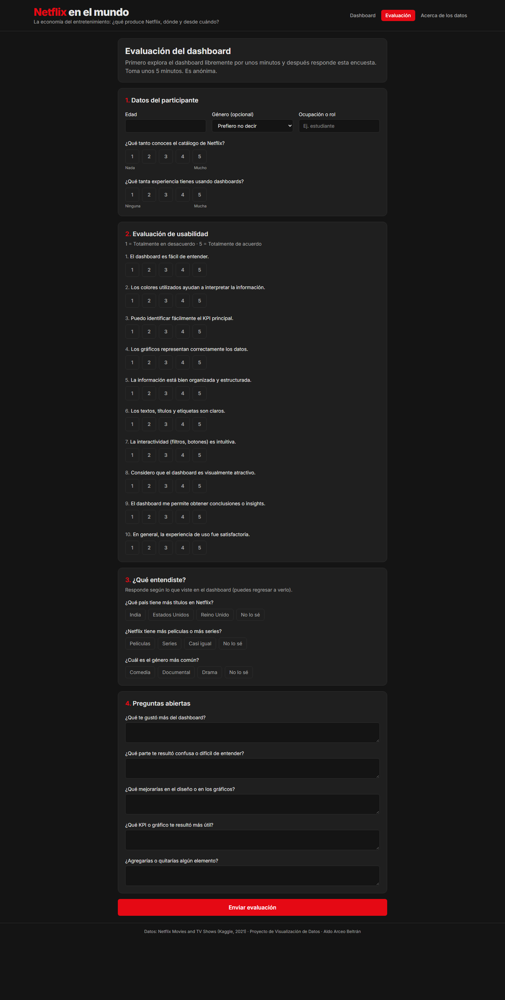
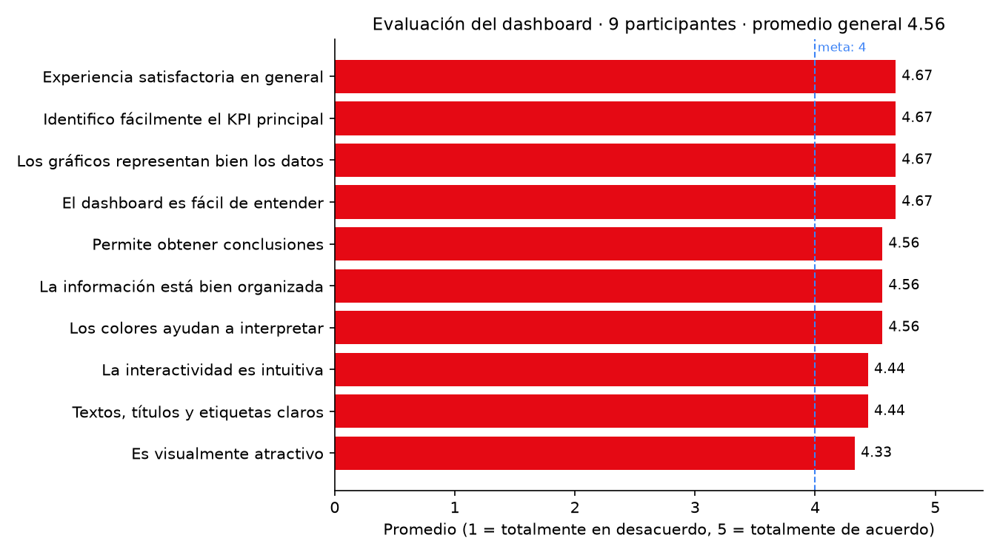

# Fase 4 · Evaluación del dashboard

**Proyecto:** Netflix en el mundo · **Autor:** Aldo Arceo Beltrán

> **Propósito:** comprobar con personas reales si el dashboard es **claro, fácil de usar, pertinente y útil**. No basta con que funcione: tiene que entenderse sin que nadie lo explique.

---

## 1. Audiencia de la evaluación

Participaron **9 personas**: 5 mujeres, 3 hombres y 1 que prefirió no decirlo. Tienen entre **20 y 55 años** (promedio 36) y perfiles distintos, lo que sirve para probar si el dashboard se entiende también fuera del ámbito técnico.

| # | Edad | Ocupación | Conoce Netflix (1–5) | Experiencia con dashboards (1–5) |
|---|---|---|---|---|
| 1 | 24 | Emprendedora | 4 | 4 |
| 2 | 55 | Ventas | 3 | 3 |
| 3 | 20 | Estudiante | 3 | 4 |
| 4 | 27 | Chofer | 3 | 2 |
| 5 | 26 | Trabajadora | 2 | 4 |
| 6 | 55 | Ama de casa | 3 | 3 |
| 7 | 23 | Cirujano dentista | 4 | 5 |
| 8 | 55 | Supervisor | 4 | 2 |
| 9 | 37 | Negocio propio | 3 | 4 |

---

## 2. Técnicas de evaluación

| Técnica | Por qué |
|---|---|
| **Cuestionario estructurado (escala 1–5)** | Las 10 afirmaciones de las indicaciones; dan **promedios comparables** |
| **Preguntas de comprensión** | 3 preguntas con respuesta correcta, para comprobar si la persona **entendió los datos** y no solo si le gustó el diseño |
| **Preguntas abiertas** | Las 5 preguntas sugeridas; recogen opiniones que los números no captan |

El cuestionario está **dentro del propio dashboard**, en la pestaña **Evaluación**. Las respuestas se guardan en la base de datos (tabla `encuestas` en Supabase) y se analizan con el script `etl/analizar_encuesta.py`.

---

## 3. Instrumento (encuesta)

- **Sección 1: participante.** Edad, género (opcional), ocupación, conocimiento de Netflix (1–5) y experiencia con dashboards (1–5).
- **Sección 2: usabilidad.** Las 10 afirmaciones de las indicaciones, de 1 (totalmente en desacuerdo) a 5 (totalmente de acuerdo).
- **Sección 3: comprensión.**
  - ¿Qué país tiene más títulos?
  - ¿Hay más películas o series?
  - ¿Cuál es el género más común?
- **Sección 4: preguntas abiertas.** Qué gustó, qué fue confuso, qué mejorarían, qué fue más útil y qué agregarían o quitarían.

---

## 4. Procedimiento

1. Se compartió el enlace del dashboard diciendo solo su propósito general: *"un dashboard sobre el catálogo de Netflix"*. **No se explicó cómo usarlo.**
2. Cada participante **exploró libremente** el dashboard.
3. Después abrió la pestaña **Evaluación** y respondió la encuesta.
4. Las respuestas se recolectaron el 20 de noviembre de 2026.

---

## 5. Resultados

### 5.1 Promedio por afirmación

| Afirmación | Promedio |
|---|---|
| El dashboard es fácil de entender | **4.67** |
| Puedo identificar fácilmente el KPI principal | **4.67** |
| Los gráficos representan correctamente los datos | **4.67** |
| En general, la experiencia fue satisfactoria | **4.67** |
| Los colores ayudan a interpretar la información | 4.56 |
| La información está bien organizada | 4.56 |
| Me permite obtener conclusiones | 4.56 |
| Los textos, títulos y etiquetas son claros | 4.44 |
| La interactividad es intuitiva | 4.44 |
| Es visualmente atractivo | 4.33 |
| **Promedio general** | **4.56 / 5** |

**Nadie calificó con 1 o 2** ninguna afirmación. La calificación más baja que se dio fue 3, y solo en algunos casos.

### 5.2 Comprensión

| Pregunta | Respuesta correcta | Aciertos |
|---|---|---|
| ¿Qué país tiene más títulos? | Estados Unidos | **9 de 9 (100%)** |
| ¿Más películas o series? | Películas | 6 de 9 (67%); 2 "No lo sé" y 1 "Casi igual" |
| ¿Género más común? | Drama | 6 de 9 (67%); 2 "No lo sé" y 1 "Comedia" |

### 5.3 Respuestas abiertas (patrones)

| Pregunta | Lo que más se repitió |
|---|---|
| ¿Qué te gustó más? | La **claridad y facilidad** de lectura (4), **el mapa** (2), los datos concretos (1) |
| ¿Qué fue confuso? | **"Ninguna"** (6). Una persona batalló con la sección de géneros y otra con ver el contenido de cada país |
| ¿Qué mejorarías? | **Nada** (4). Algunos pidieron **mejorar el diseño de las gráficas** (2) y **colores más llamativos / menos rojo** (2) |
| ¿Qué fue más útil? | **El mapa** (3), "todos" (2), los géneros (1) |
| ¿Agregarías algo? | **"No"** (6). Ideas: **las películas más vistas** y **qué género se ve más en cada país** |

Un comentario destacado: *"me gustó que se pareciera a la aplicación de Netflix"*. Confirma la decisión de la paleta tomada en la Fase 2.

---

## 6. Análisis e interpretación

| Aspecto | Preguntas | Resultado | Lectura |
|---|---|---|---|
| **Usabilidad** | 1, 7 | 4.67 · 4.44 | Se entiende sin explicación. La interactividad sale un poco más baja que el resto |
| **Comprensión de la información** | 6, 9 + comprensión | 4.44 · 4.56 · 67–100% | El KPI principal se entiende perfecto; los datos de la parte baja se entienden menos |
| **Pertinencia de los KPIs** | 3 + "más útil" | 4.67 | El KPI principal **sí se percibe como el principal**, y el mapa fue lo más mencionado |
| **Estética y diseño** | 2, 5, 8 | 4.56 · 4.56 · 4.33 | Ordenado y coherente; "atractivo" es lo más bajo, por el exceso de rojo |
| **Impacto y utilidad** | 9, 10 | 4.56 · 4.67 | Los usuarios sienten que pueden sacar conclusiones |

**Interpretación principal:** la **jerarquía visual funcionó**.
- Lo que se diseñó como **Nivel 1** (KPI principal y mapa) lo entendió el **100%** de los participantes.
- Lo que está más abajo, en los **Niveles 2 y 3** (dona de películas/series y géneros), lo entendió el **67%**, y los demás respondieron casi siempre "No lo sé".

Esto indica que los usuarios **se concentraron en la parte alta** y no todos recorrieron la página completa. Es justo el orden de importancia que se planeó, pero también muestra que la información de abajo podría destacarse más.

---

## 7. Hallazgos

### ✅ Aspectos que funcionan bien
- **El KPI principal se identifica de inmediato:** 4.67 de promedio y 100% de aciertos.
- **El mapa** es el elemento más valorado y el más útil.
- **Fácil de entender** para cualquier perfil: los 9 participantes calificaron la facilidad con 4 o 5, incluidos quienes tienen poca experiencia con dashboards.
- **La identidad visual tipo Netflix** se reconoce y gusta.

### ⚠️ Problemas detectados
- **Los datos de la parte inferior se ven menos.** 1 de cada 3 no supo si hay más películas o series, ni cuál es el género más común.
- **La sección de géneros** le resultó difícil a una persona.
- **Demasiado rojo** para algunos usuarios ("menos rojo", "colores más llamativos"). "Visualmente atractivo" fue la calificación más baja (4.33).
- Una persona quería **ver qué género domina en cada país**. **Esto ya se puede hacer** (clic en un país del mapa → el Top 5 de géneros cambia), pero no lo descubrió. Es un problema de **descubrimiento de la interacción**, no de falta de datos.

### 💡 Recomendaciones de mejora
1. **Hacer más visible que el mapa filtra todo.** Por ejemplo, un mensaje tipo *"Prueba: haz clic en India"* o un botón con 3 países de ejemplo.
2. **Subir la información clave de la parte baja.** Por ejemplo, poner "70% películas" y "Género #1" como texto dentro de los KPIs superiores, para que se vean sin bajar.
3. **Usar menos rojo:** reservarlo solo para el KPI principal y el líder, y usar tonos más suaves en el resto de las barras.
4. **"Películas más vistas":** el dataset **no incluye** visualizaciones ni popularidad, así que no se puede agregar con estos datos. Sería una mejora futura con otra fuente, como el Top 10 oficial de Netflix.

### Cambios aplicados
Por el alcance y los tiempos de la entrega, **no se modificó el dashboard** después de la evaluación. Las recomendaciones quedan documentadas como **siguiente versión**. Ninguna requiere cambiar los KPIs ni la estructura: son ajustes de presentación.

---

## 8. Conclusión

El dashboard **cumple su propósito analítico**:
- Obtuvo **4.56 de 5** en promedio.
- Ninguna afirmación tuvo una calificación negativa.
- **Todos** los participantes identificaron correctamente el hallazgo principal: Estados Unidos domina el catálogo de Netflix.

La evaluación también mostró algo que no se veía al diseñar: **lo que está arriba se entiende muy bien, y lo que está abajo se pierde un poco**. Eso confirma que la jerarquía visual sí guía la atención, pero también que un dato importante no debe quedar solo al final de la página. Esta fase enseñó a pensar como **diseñador de información centrado en el usuario**: no basta con que el dashboard sea correcto, también tiene que llevar al usuario a ver lo importante.

---

## Repositorio

- **Repositorio del proyecto:** https://github.com/Gghoul11/netflix-dashboard
- **Dashboard en vivo:** https://caldo-netflix-dashboard-alpha.vercel.app
- **Encuesta:** https://caldo-netflix-dashboard-alpha.vercel.app/evaluacion
