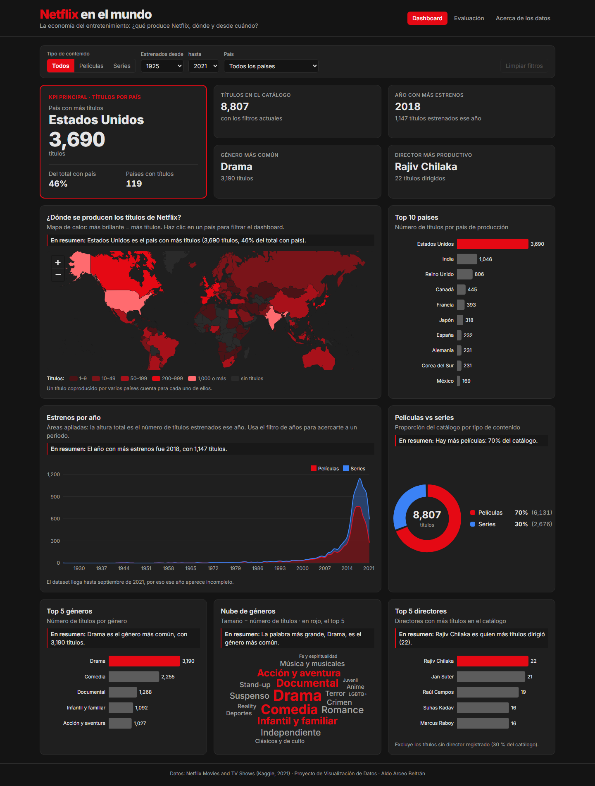

# Fase 4 · Evaluación del dashboard

**Proyecto:** Netflix en el mundo · **Autor:** Aldo Arceo Beltrán

> **Propósito:** comprobar con personas reales si el dashboard es **claro, fácil de usar, pertinente y útil**. No basta con que funcione: tiene que entenderse sin que nadie lo explique.

**Resultado en una línea:** 4 participantes, **promedio general de 4.53 de 5**. Las 10 afirmaciones quedaron por encima de la meta de 4. El punto débil fue **la sección de géneros**, y se corrigió.

---

## 1. Audiencia de la evaluación

Participaron **4 personas** (la indicación pide mínimo 3), con perfiles variados en edad, ocupación y experiencia. Así se probó el dashboard con gente que **sí** y que **no** usa dashboards con frecuencia.

| # | Edad | Género | Ocupación | Conoce Netflix (1–5) | Experiencia con dashboards (1–5) |
|---|---|---|---|---|---|
| 1 | 24 | Mujer | Emprendedora | 4 | 4 |
| 2 | 55 | Prefirió no decir | Ventas | 3 | 3 |
| 3 | 20 | Hombre | Estudiante | 3 | 4 |
| 4 | 27 | Hombre | Chofer | 3 | 2 |

**Rango de edad:** 20 a 55 años. **Experiencia con dashboards:** de baja (2) a alta (4).

---

## 2. Técnicas de evaluación elegidas

| Técnica | Por qué |
|---|---|
| **Cuestionario estructurado (escala 1–5)** | Las 10 afirmaciones de las indicaciones; dan **promedios comparables**. |
| **Preguntas de comprensión** | 3 preguntas con respuesta correcta, para comprobar si la persona **entendió los datos** y no solo si le gustó. |
| **Preguntas abiertas** | Las 5 preguntas sugeridas; recogen opiniones que los números no captan. |

El cuestionario está **dentro del propio dashboard** (pestaña **Evaluación**) y las respuestas se guardan en la base de datos (tabla `encuestas` en Supabase). Se analizaron con el script `etl/analizar_encuesta.py`.

---

## 3. Instrumento (encuesta)

**Sección 1: Datos del participante**
- Edad, género (opcional) y ocupación.
- Conocimiento de Netflix (1–5).
- Experiencia con dashboards (1–5).

**Sección 2: Usabilidad** (1 = totalmente en desacuerdo, 5 = totalmente de acuerdo)
1. El dashboard es fácil de entender.
2. Los colores utilizados ayudan a interpretar la información.
3. Puedo identificar fácilmente el KPI principal.
4. Los gráficos representan correctamente los datos.
5. La información está bien organizada y estructurada.
6. Los textos, títulos y etiquetas son claros.
7. La interactividad (filtros, botones) es intuitiva.
8. Considero que el dashboard es visualmente atractivo.
9. El dashboard me permite obtener conclusiones o insights.
10. En general, la experiencia de uso fue satisfactoria.

**Sección 3: Comprensión** (con respuesta correcta)
- ¿Qué país tiene más títulos? → *Estados Unidos*
- ¿Más películas o más series? → *Películas*
- ¿Cuál es el género más común? → *Drama*

**Sección 4: Preguntas abiertas**
- ¿Qué te gustó más del dashboard?
- ¿Qué parte te resultó confusa?
- ¿Qué mejorarías?
- ¿Qué KPI o gráfico te resultó más útil?
- ¿Agregarías o quitarías algún elemento?

---

## 4. Procedimiento

1. Se compartió el enlace del dashboard explicando **solo su propósito general**: *"es un dashboard sobre el catálogo de Netflix"*. No se explicó cómo usarlo.
2. Cada participante **exploró libremente** el dashboard.
3. Al terminar, abrió la pestaña **Evaluación** y contestó la encuesta. Así se respondió **después** de usarlo, como recomiendan las indicaciones.
4. Las respuestas se analizaron con datos cuantitativos (promedios y % de aciertos) y cualitativos (patrones en las respuestas abiertas).

---

## 5. Resultados

### 5.1 Promedio por afirmación

| Afirmación | Promedio | Lectura |
|---|---|---|
| El dashboard es fácil de entender | **4.75** | Fortaleza |
| Textos, títulos y etiquetas claros | **4.75** | Fortaleza |
| Experiencia satisfactoria en general | **4.75** | Fortaleza |
| Identifico fácilmente el KPI principal | 4.50 | Fortaleza |
| Los gráficos representan bien los datos | 4.50 | Fortaleza |
| La información está bien organizada | 4.50 | Fortaleza |
| La interactividad es intuitiva | 4.50 | Fortaleza |
| Permite obtener conclusiones | 4.50 | Fortaleza |
| Los colores ayudan a interpretar | 4.25 | Fortaleza (la más baja) |
| Es visualmente atractivo | 4.25 | Fortaleza (la más baja) |
| **Promedio general** | **4.53** | |

**Criterio:** ≥ 4 es fortaleza, entre 3.5 y 4 es aceptable y menos de 3.5 es debilidad.

### 5.2 Comprensión

| Pregunta | Respuesta correcta | Aciertos |
|---|---|---|
| ¿Qué país tiene más títulos? | Estados Unidos | **4 de 4 (100%)** |
| ¿Más películas o series? | Películas | 3 de 4 (75%) |
| ¿Cuál es el género más común? | Drama | **2 de 4 (50%)** |

Respuestas incorrectas:
- **Tipo de contenido:** un participante contestó "No lo sé".
- **Género:** un participante contestó "Comedia" y otro "No lo sé".

### 5.3 Respuestas abiertas (resumen)

| Pregunta | Lo que dijeron | Patrón |
|---|---|---|
| ¿Qué te gustó más? | "El mapa interactivo" · "Qué es sencillo de entender" · "Que tiene datos concretos y precisos" | **El mapa** y la **sencillez** |
| ¿Qué fue confuso? | 3 × "Ninguna" · "La parte donde viene el género, es entendible pero me costó" | Solo **géneros** generó dudas |
| ¿Qué mejorarías? | "Nada, me gustó que se pareciera a la aplicación de Netflix" · "Nada" · "Diseño de las graficas" · "Posiblemente el diseño" | 2 piden pulir el **diseño de las gráficas** |
| ¿Qué KPI o gráfico fue más útil? | "El del mapa para ver país por país…" · "Todos" · "En el mapa donde se ve por colores…" | **El mapa (KPI principal)**, 2 de 3 menciones |
| ¿Agregarías o quitarías algo? | 3 × "No" · "Agregaría cuáles fueron las películas y series más vistas" | 1 sugerencia de **popularidad** |

---

## 6. Análisis e interpretación

| Aspecto (indicaciones) | Evidencia | Interpretación |
|---|---|---|
| **Usabilidad** | Fácil de entender 4.75 · interactividad 4.50 | Se usa sin explicación previa |
| **Comprensión de la información** | Textos claros 4.75 · 100% acertó el país líder | Los títulos y etiquetas funcionan. Pero **no todos sacaron la conclusión de los géneros** (50%) |
| **Pertinencia de los KPIs** | KPI principal identificable 4.50 · el mapa fue el más útil | **El KPI principal cumple su papel**: es lo primero que se ve y lo que más se recuerda |
| **Estética y diseño visual** | Colores 4.25 · atractivo 4.25 | Son las notas más bajas, aunque siguen sobre la meta. Un participante valoró el parecido con Netflix y dos piden mejorar el diseño de las gráficas |
| **Interactividad y navegación** | 4.50 | Los filtros y el clic en el mapa se entienden |
| **Impacto y utilidad** | Conclusiones 4.50 · satisfacción 4.75 | El dashboard cumple su propósito analítico |

**Lectura importante: la diferencia por experiencia.**
- Los participantes con experiencia media o alta en dashboards (1 y 3) calificaron todo con 5.
- El participante 2 (55 años, experiencia media) dio las notas más bajas (3 en colores, KPI, gráficos, organización y conclusiones) y respondió "No lo sé" en dos preguntas de comprensión.

Esto indica que el dashboard es claro para quien ya sabe leer gráficos, pero **a un usuario menos habituado le falta que el dashboard le diga la conclusión en palabras**.

---

## 7. Hallazgos

### ✅ Aspectos que funcionan bien
- **El KPI principal y el mapa.** El 100% identificó el país con más títulos, y el mapa fue el elemento más mencionado como útil y como lo que más gustó.
- **Claridad de textos y facilidad de uso:** 4.75 cada uno, las notas más altas.
- **Identidad visual.** El parecido con Netflix (rojo y negro) se percibió como algo positivo.
- **Ninguna afirmación quedó debajo de 4.**

### ⚠️ Problemas detectados
1. **La sección de géneros es la menos clara.** Solo 50% acertó el género más común, y fue lo único que alguien marcó como confuso. Probable causa: la nube de palabras muestra varios géneros grandes en rojo (Comedia también es muy grande) y el top 5 está en la última fila, que es la de menor jerarquía.
2. **Los usuarios con menos experiencia** no siempre sacan la conclusión solo con ver un gráfico.
3. **El diseño de las gráficas** tiene las notas más bajas (4.25 en colores y en atractivo), aunque siguen sobre la meta. Es lo que más se puede pulir.

### 💡 Recomendaciones de mejora
| Recomendación | Viabilidad | Estado |
|---|---|---|
| Escribir la **conclusión de cada gráfico en una frase** ("En resumen: Drama es el género más común…") | Alta | ✅ **Aplicada** |
| Agregar los títulos **más vistos** | No es viable con este dataset: no incluye vistas ni popularidad. Requeriría otra fuente, como el Top 10 oficial de Netflix | Documentada como trabajo futuro |
| Pulir el diseño de las gráficas (por ejemplo, resaltar solo "Drama" en la nube) | Media | Propuesta para una siguiente versión |

### Cambio aplicado después de la evaluación

Cada gráfico ahora tiene una línea **"En resumen"** con su conclusión, que se recalcula con los filtros. Por ejemplo:
- *"Estados Unidos es el país con más títulos (3,690 títulos, 46% del total con país)."*
- *"Drama es el género más común, con 3,190 títulos."*
- *"La palabra más grande, Drama, es el género más común."*

Esto ataca directamente el problema principal: el usuario ya no tiene que deducir la conclusión, la lee. Se implementó en `Tarjeta.jsx` (nuevo campo `lectura`) y en `Dashboard.jsx`.

---

## 8. Conclusión

La evaluación confirma que el dashboard **cumple su propósito**:
- se entiende sin explicación (4.75);
- el KPI principal se identifica y se recuerda (100% de aciertos);
- permite sacar conclusiones (4.50).

La fase también mostró algo que no se veía desde el diseño: **lo que es obvio para quien hizo el dashboard no lo es para todos los usuarios**. Que alguien diga que el diseño "es entendible" no garantiza que saque la conclusión correcta. Por eso fue valioso medir la **comprensión** con preguntas de respuesta correcta y no solo la satisfacción.

La mejora aplicada convierte al dashboard de un conjunto de gráficos en un producto que **dice lo que muestra**, más cercano a la meta de la visualización de datos: informar y facilitar decisiones.

**Limitaciones:**
- La muestra es pequeña (4 personas), así que los promedios son orientativos.
- El dataset no incluye popularidad, por lo que no se puede responder qué es "lo más visto".

---

## Repositorio

El proyecto está en el repositorio: **https://github.com/Gghoul11/netflix-dashboard**
Dashboard en vivo: **https://caldo-netflix-dashboard-alpha.vercel.app**
Encuesta: **https://caldo-netflix-dashboard-alpha.vercel.app/evaluacion**
